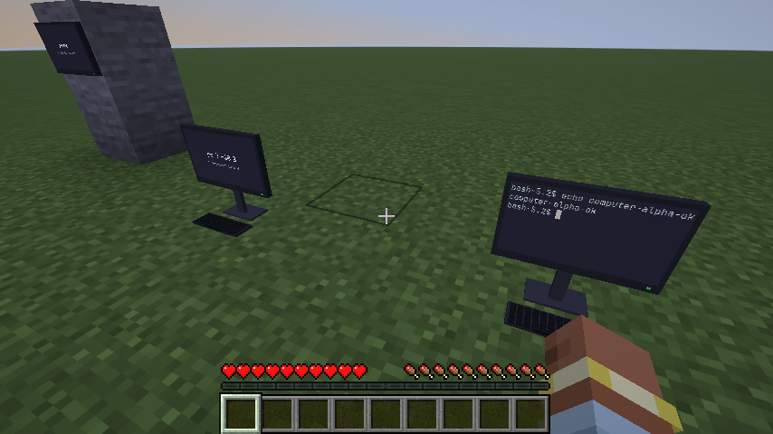
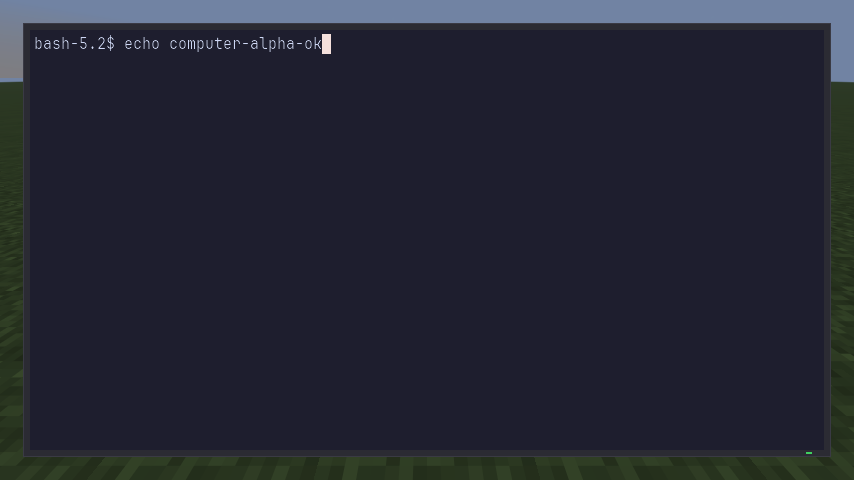

# Minecraft Terminal

A real terminal inside Minecraft. Press **K**.

## Install

Easiest: the one-click setup for our server, which includes this mod:
https://github.com/pronnmark/minecraft-server#join

Or put `minecraft-terminal-<version>.jar` from
[Releases](https://github.com/pronnmark/minecraft-terminal/releases/latest) and
[Fabric API](https://modrinth.com/mod/fabric-api) into a Fabric 26.3 `mods` folder.

## Use

**K** opens a terminal on your computer. Write `pc` on a sign (or `[pc]`, optionally with a
name after it or on the next line), then right-click the sign: each sign is its own computer.
A sign with no name is named after where it stands. Hanging signs are not computers. Sneak + right-click edits the sign.
A computer sign is drawn as a computer: a monitor showing its live screen, on a stand with a
keyboard (a wall sign becomes a wall monitor). Right-click it and you sit down at it: the screen
fills 90% of your window and the world stays visible around it. Close it and the computer keeps
running on its monitor. Computers are drawn by your own game, so other players see a computer
but not your screen on it, and players without the mod see a sign.

| key (Mac / other) | action |
|---|---|
| Cmd+W / Ctrl+Shift+W | leave (the terminal keeps running) |
| Cmd+V / Ctrl+Shift+V | paste |
| Cmd+= and Cmd+- | text size |
| Cmd+, / Ctrl+Shift+, | connect to another machine: type an SSH host to open [herdr](https://herdr.dev) there; a `[pc]` sign then opens the herdr space with its name |

## Notes

- Minecraft Java 26.3. macOS and Linux tested; Windows (PowerShell) untested.
- The terminal has your user's rights. A sign's name is typed only as letters, digits, spaces and
  `. _ -`, so a sign someone else wrote cannot run commands.
- Build: `./gradlew build` (JDK 25) → `build/libs/*.jar`. Release: bump `version`, tag `v<version>`, push the tag.
- Licences: code MIT; fonts SIL OFL 1.1 (`licenses/`); JediTerm Apache-2.0/LGPL-3.0, pty4j EPL-1.0.
